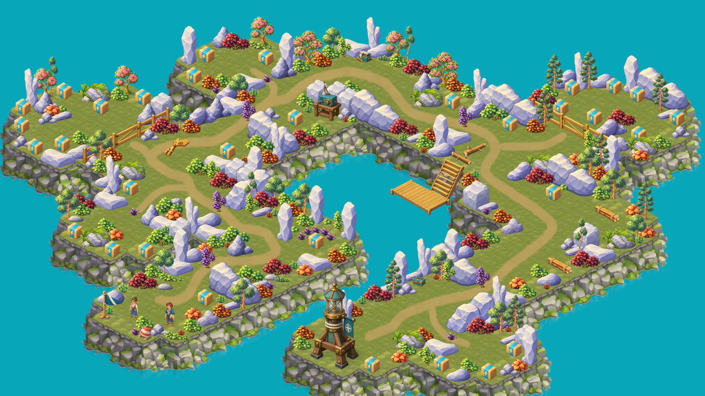

# Postal Cove — Свет для бухты

**Vlad Pinchuk — Level Designer** · [LinkedIn](https://www.linkedin.com/in/vlad-pinchuk)

**[Открыть проект](https://vaihiker.github.io/postal-cove/)** · **[Видео прохождения](https://youtu.be/bBDQV3LwVJs)**

Компактная островная экспедиция в жанре farm adventure, собранная в Unity. После шторма Нико помогает Норе восстановить связь, подготовить причал и вернуть свет маяку, чтобы почтовая лодка смогла доставить письмо.

## Дизайн локации

- Основная тропа связывает поляны, квестовые объекты и карманы с припасами.
- Расчистка проходов постепенно открывает территорию и продолжение истории.
- Запас энергии поддерживает продвижение: ящики на пути, за преградами и в огороженных карманах.

На странице проекта представлены сеттинг, сюжет, квесты, диалоги, схема маршрута и объяснение расстановки. Видео показывает полное прохождение со звуком, включая все карманы с припасами.

[Сюжет и квесты](https://vaihiker.github.io/postal-cove/#quests) · [Схема локации](https://vaihiker.github.io/postal-cove/#map) · [Логика расстановки](https://vaihiker.github.io/postal-cove/#design)
